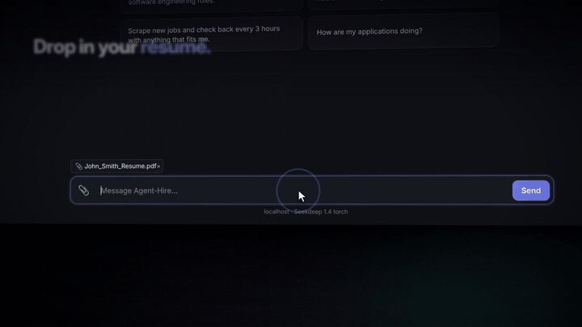

<p align="center">
  
</p>

<h1 align="center">Agent-Hire</h1>

<p align="center">
  <b>Your job hunt on autopilot.</b><br />
  A local AI agent that finds fresh jobs on company career sites, tailors your résumé for each one,
  and fills the application forms — you just press Submit.
</p>

<!-- Demo video: on github.com, edit this README and drag docs/media/agent-hire-demo.mp4 onto the
     next line. GitHub replaces it with a video link that plays right here. -->
<p align="center"></p>

## Install

**Linux**

```bash
curl -fsSL https://raw.githubusercontent.com/Qilun-ai/Agent-Hire/main/install.sh | bash
```

**Windows** (PowerShell)

```powershell
irm https://raw.githubusercontent.com/Qilun-ai/Agent-Hire/main/install.ps1 | iex
```

The installer asks where to put Agent-Hire (default `~/Agent-Hire`), downloads the app and its two
job models, adds the `agent-hire` command and opens the app. Run the same command again to update;
your data stays. Then load the browser extension from `<install folder>/extension`
(chrome://extensions → Developer mode → Load unpacked).

AI keys already in your environment (`OPENAI_API_KEY`, `GEMINI_API_KEY`, `OPENCODE_API_KEY`,
`ANTHROPIC_API_KEY`, …) are picked up automatically, or paste one in Settings.

## How it works

1. **Tell it what you want.** Attach your résumé in the chat and describe the role.
2. **It finds jobs.** Agent-Hire scrapes company career sites in the background and checks back with
   new matches.
3. **It picks the right ones.** Jobs are filtered by date, role, level and your skills.
4. **It tailors your résumé** for each job you choose.
5. **You apply in one click.** The browser extension fills the form; you review and press Submit.
   Replies in your inbox update the Applications tab.

## Companies it scrapes

<!-- companies:start -->
<details>
<summary><b>237 company career sites</b> (click to expand)</summary>

| | | |
|---|---|---|
| [42 Gears](https://www.42gears.com/careers/) | [Accenture](https://www.accenture.com/in-en/careers/jobsearch) | [Addverb Technologies](https://addverb.com/careers/) |
| [Adobe](https://careers.adobe.com/) | [Air Asia](https://careers.airasia.com/) | [Airbnb](https://careers.airbnb.com/positions/) |
| [Airoha Technology](https://www.airoha.com/recruit/jobs) | [Alphawave Semi](https://awavesemi.com/careers/) | [Amagi](https://www.amagi.com/careers) |
| [Amagi Media Labs](https://www.amagi.com/careers) | [AMD](https://careers.amd.com/careers-home/jobs) | [American Express](https://www.americanexpress.com/en-us/careers/) |
| [Apple](https://jobs.apple.com/en-us/search) | [Applied Materials](https://www.appliedmaterials.com/us/en/careers.html) | [Arcesium](https://www.arcesium.com/careers) |
| [Arista Networks](https://www.arista.com/en/careers) | [Atlan](https://atlan.com/careers/) | [Atlassian](https://www.atlassian.com/company/careers/all-jobs) |
| [Autodesk](https://jobs.autodesk.com/careers) | [auxoAI](https://auxo.ai/careers) | [Bajaj Finserv](https://www.bajajfinserv.in/careers) |
| [Baker Hughes](https://careers.bakerhughes.com/global/en/search-results) | [Barclays](https://search.jobs.barclays/search-jobs) | [BharatPe](https://bharatpe.com/career/) |
| [BharatX](https://bharatx.tech/) | [BlackRock](https://careers.blackrock.com/search-jobs) | [BNY Mellon](https://www.bny.com/corporate/global/en/careers.html) |
| [Boeing](https://jobs.boeing.com/search-jobs) | [Bosch Global Software Technologies](https://www.bosch-softwaretechnologies.com/en/careers/) | [Broadcom](https://www.broadcom.com/company/careers) |
| [BrowserStack](https://www.browserstack.com/careers) | [ByteDance](https://jobs.bytedance.com/en/position) | [Calendly](https://careers.calendly.com/) |
| [Canva](https://www.lifeatcanva.com/en/jobs/) | [Capital One](https://www.capitalonecareers.com/search-jobs) | [Cashfree](https://www.cashfree.com/careers/) |
| [Celigo](https://www.celigo.com/careers/) | [Chargebee](https://www.chargebee.com/careers/) | [Check Point](https://careers.checkpoint.com/) |
| [Cisco](https://jobs.cisco.com/) | [Citadel Securities](https://www.citadelsecurities.com/careers/open-opportunities/) | [Citibank](https://jobs.citi.com/search-jobs) |
| [CleverTap](https://clevertap.com/careers/) | [Cloudera](https://www.cloudera.com/careers.html) | [Cognizant](https://careers.cognizant.com/global-en/jobs/) |
| [Cohesity](https://www.cohesity.com/company/careers/) | [Commvault Systems Pvt Ltd](https://www.commvault.com/careers) | [Confluent](https://careers.confluent.io/jobs) |
| [ConveGenius](https://convegenius.com/careers.html) | [CRED](https://careers.cred.club/) | [CrowdStrike](https://www.crowdstrike.com/en-us/careers/) |
| [Cure.fit](https://www.cult.fit/careers) | [Cursor](https://cursor.com/careers) | [Cyware](https://cyware.com/careers) |
| [D.E. Shaw](https://www.deshawindia.com/careers) | [Da Vinci](https://davincitrading.com/careers/) | [Darwinbox](https://darwinbox.com/careers/) |
| [Databricks](https://www.databricks.com/company/careers/open-positions) | [Datadog](https://careers.datadoghq.com/all-jobs/) | [Delhivery](https://www.delhivery.com/company/careers) |
| [Dell Technologies](https://jobs.dell.com/search-jobs) | [Deutsche Bank](https://careers.db.com/professionals/search-roles/) | [DevRev](https://devrev.ai/careers) |
| [DigitalOcean](https://www.digitalocean.com/careers) | [Discord](https://discord.com/careers) | [Dozee](https://www.dozeehealth.ai/careers) |
| [Druva](https://www.druva.com/about/careers) | [eBay](https://careers.ebayinc.com/us/en/jobs/) | [Elastic](https://www.elastic.co/careers/jobs) |
| [Electronic Arts](https://www.ea.com/careers) | [Enphase Energy](https://enphase.com/careers) | [Etsy](https://careers.etsy.com/jobs) |
| [Expedia Group](https://careers.expediagroup.com/jobs/) | [FAREPORTAL](https://www.fareportal.com/careers/) | [Fastenal](https://careers.fastenal.com/) |
| [Fidelity](https://jobs.fidelity.com/) | [Figma](https://www.figma.com/careers/) | [Flexcar IDC](https://www.flexcar.com/careers) |
| [Flipkart](https://www.flipkartcareers.com/) | [Flow Traders](https://www.flowtraders.com/careers/) | [Fortinet](https://www.fortinet.com/corporate/careers) |
| [Fractal Analytics](https://fractal.ai/careers/) | [Freshworks](https://www.freshworks.com/company/careers/) | [GitHub](https://www.github.careers/careers-home/jobs) |
| [GitLab](https://about.gitlab.com/jobs/all-jobs/) | [Glean](https://www.glean.com/careers) | [Gojek](https://www.gojek.io/careers) |
| [Goldman Sachs](https://www.goldmansachs.com/careers) | [Google](https://www.google.com/about/careers/applications/jobs/results/) | [Graviton Research Capital](https://www.gravitonresearch.com/careers) |
| [Groww](https://groww.in/careers) | [Gullak Money](https://www.gullak.money/) | [HackerEarth](https://www.hackerearth.com/careers/) |
| [HackerRank](https://www.hackerrank.com/careers) | [Harness](https://www.harness.io/company/careers) | [HashiCorp](https://www.hashicorp.com/en/career) |
| [Hasura](https://hasura.io/careers/) | [HCL Technologies](https://www.hcltech.com/careers) | [HDFC Bank](https://www.hdfcbank.com/personal/about-us/careers) |
| [Hella Infra Market Private Limited](https://infra.market/careers/) | [Hewlett Packard Enterprise](https://careers.hpe.com/us/en/search-results) | [HighRadius](https://www.highradius.com/about/careers/) |
| [HP](https://jobs.hp.com/) | [HSBC](https://www.hsbc.com/careers/find-a-job) | [HyperVerge](https://hyperverge.co/careers/) |
| [IBM](https://www.ibm.com/careers/search) | [Icertis](https://www.icertis.com/company/careers/) | [ICICI Bank](https://www.icicicareers.com/) |
| [IMC Trading](https://www.imc.com/us/careers/jobs) | [Infosys](https://www.infosys.com/careers/apply.html) | [InMobi](https://www.inmobi.com/company/careers) |
| [Innovaccer](https://innovaccer.com/careers) | [Intel](https://jobs.intel.com/en/search-jobs) | [Intuit](https://jobs.intuit.com/search-jobs) |
| [JetBrains](https://www.jetbrains.com/careers/jobs/) | [JPMorgan Chase](https://careers.jpmorgan.com/global/en/home) | [Jupiter](https://jupiter.money/careers/) |
| [JUSPAY](https://juspay.in/careers) | [Kaleyra](https://www.kaleyra.com/careers/) | [Komprise India Private](https://www.komprise.com/company/careers/) |
| [Kotak Mahindra](https://www.kotak.com/en/about-us/careers.html) | [L&T Infotech](https://www.ltimindtree.com/careers/) | [LeadSquared](https://www.leadsquared.com/careers/) |
| [Lenskart](https://www.lenskart.com/careers) | [LetsTransport](https://letstransport.in/careers/) | [LinkedIn](https://careers.linkedin.com/) |
| [Loom](https://www.loom.com/careers) | [MAKEMYTRIP](https://careers.makemytrip.com/) | [Mastercard](https://careers.mastercard.com/us/en/search-results) |
| [Maxlinear Technologies](https://www.maxlinear.com/company/careers) | [Media.net](https://careers.media.net/) | [Meesho](https://www.meesho.io/jobs) |
| [Meta](https://www.metacareers.com/jobs/) | [Micron Technology](https://careers.micron.com/) | [Microsoft](https://careers.microsoft.com/) |
| [Mindtree](https://www.ltimindtree.com/careers/) | [MONEYVIEW](https://moneyview.in/careers) | [MongoDB](https://www.mongodb.com/company/careers) |
| [Morgan Stanley](https://www.morganstanley.com/people-opportunities) | [Mphasis](https://careers.mphasis.com/) | [Myntra](https://careers.myntra.com/) |
| [Nagarro](https://www.nagarro.com/en/careers) | [Navi Technologies](https://navi.com/careers) | [NetApp](https://careers.netapp.com/search-jobs) |
| [Netflix](https://explore.jobs.netflix.net/careers) | [Netlify](https://www.netlify.com/careers/) | [Neysa Networks](https://neysa.ai/careers/) |
| [NK Securities](https://www.nksecurities.com/open-positions.html) | [Nomura](https://www.nomura.com/careers/) | [Notion](https://www.notion.com/careers) |
| [Nutanix](https://www.nutanix.com/company/careers) | [NVIDIA](https://www.nvidia.com/en-us/about-nvidia/careers/) | [OfBusiness](https://www.ofbusiness.com/careers) |
| [Okta](https://www.okta.com/company/careers/) | [Ola](https://www.olacabs.com/careers) | [OpenAI](https://openai.com/careers/search/) |
| [Optiver](https://optiver.com/working-at-optiver/career-opportunities/) | [Oracle](https://www.oracle.com/careers/) | [Oracle GBU](https://www.oracle.com/careers/) |
| [PagerDuty](https://www.pagerduty.com/careers/) | [Palo Alto Networks](https://jobs.paloaltonetworks.com/en) | [PayPal](https://careers.pypl.com/home/) |
| [Paytm](https://paytm.com/careers/) | [PayU](https://corporate.payu.com/careers/) | [Persistent Systems](https://www.persistent.com/careers/) |
| [Philips Lighting (Signify)](https://www.careers.signify.com/global/en/search-results) | [PhonePe](https://www.phonepe.com/careers/) | [PlanetScale](https://planetscale.com/careers) |
| [Pocket FM](https://www.pocketfm.com/careers) | [Pocketpills](https://www.pocketpills.com/careers) | [Postman](https://www.postman.com/company/careers/) |
| [Providence](https://www.providence.jobs/) | [Publicis Sapient](https://careers.publicissapient.com/) | [Quadeye (QE Securities)](https://www.quadeye.com/careers/) |
| [Qualcomm](https://careers.qualcomm.com/careers) | [Rapid7](https://careers.rapid7.com/jobs) | [Razorpay](https://razorpay.com/jobs/) |
| [Redis](https://redis.io/careers/) | [Richpanel](https://www.richpanel.com/careers) | [Sabre Corporation](https://www.sabre.com/careers/) |
| [Salesforce](https://careers.salesforce.com/en/jobs/) | [Samsung Semiconductor India Research](https://semiconductor.samsung.com/careers/) | [Sandvine](https://www.sandvine.com/company/careers) |
| [SAP](https://jobs.sap.com/search/) | [SAP Labs](https://jobs.sap.com/search/) | [Sarvam AI](https://www.sarvam.ai/careers) |
| [Schlumberger](https://careers.slb.com/) | [SecPod Technologies](https://www.secpod.com/careers/) | [SendGrid](https://sendgrid.com/en-us/careers) |
| [ServiceNow](https://careers.servicenow.com/jobs/) | [ShareChat](https://sharechat.com/careers) | [Shopify](https://www.shopify.com/careers) |
| [Siemens EDA](https://eda.sw.siemens.com/en-US/careers/) | [Silicon Labs](https://www.silabs.com/about-us/careers) | [Slack](https://slack.com/careers) |
| [Slice](https://www.sliceit.com/careers) | [Snowflake](https://careers.snowflake.com/us/en/search-results) | [Societe Generale](https://careers.societegenerale.com/en/search) |
| [Sony Japan](https://www.sony.com/en/SonyInfo/Careers/) | [Spotify](https://www.lifeatspotify.com/jobs) | [Sprinklr](https://www.sprinklr.com/careers/) |
| [SquadStack](https://www.squadstack.com/careers) | [Standard Chartered](https://jobs.sc.com/search-jobs) | [Stripe](https://stripe.com/jobs/search) |
| [Supabase](https://supabase.com/careers) | [Swiggy](https://careers.swiggy.com/) | [Taiwan Semiconductor (TSMC)](https://careers.tsmc.com/) |
| [Target](https://corporate.target.com/careers/job-search) | [TCS](https://www.tcs.com/careers) | [Tech Mahindra](https://careers.techmahindra.com/) |
| [Tekion India Private Limited](https://tekion.com/careers) | [Texas Instruments](https://careers.ti.com/) | [Tower Research](https://tower-research.com/open-positions/) |
| [Twilio](https://www.twilio.com/en-us/company/jobs) | [Uber](https://www.uber.com/us/en/careers/list/) | [UBS](https://www.ubs.com/global/en/careers/search-jobs.html) |
| [Upstox](https://upstox.com/careers/) | [Urban Company](https://www.urbancompany.com/careers) | [Varonis](https://www.varonis.com/company/careers) |
| [Vercel](https://vercel.com/careers) | [Visa](https://corporate.visa.com/en/careers.html) | [VMware](https://careers.vmware.com/) |
| [Walmart Global Tech India](https://tech.walmart.com/content/walmart-global-tech/en_us/careers.html) | [Walmart Labs](https://tech.walmart.com/content/walmart-global-tech/en_us/careers.html) | [WebEngage](https://webengage.com/careers/) |
| [Wells Fargo](https://www.wellsfargojobs.com/en/jobs/) | [Whatfix](https://whatfix.com/careers/) | [Wingify](https://wingify.com/careers) |
| [Wipro](https://careers.wipro.com/careers-home/jobs) | [WorldQuant Research](https://www.worldquant.com/career-listing/) | [Yellow.ai](https://yellow.ai/careers/) |
| [Zepto](https://www.zepto.com/careers) | [Zerodha](https://careers.zerodha.com/) | [Zeta](https://www.zeta.tech/us/careers/) |
| [Zoho](https://www.zoho.com/careers/) | [Zoom](https://careers.zoom.us/jobs/search) | [Zynga](https://www.zynga.com/jobs/) |

</details>
<!-- companies:end -->

## Privacy

Everything runs on your computer. Your profile, documents, jobs and chats stay in the install folder,
and on Linux the app runs sandboxed to that folder. Nothing is uploaded except the requests you make
to the AI provider you choose. The extension never presses Submit for you.

## Learn more

[Install options and updates](docs/install-package.md) · [AI providers](docs/ai-providers.md) ·
[Decision model](docs/decision-model-settings.md) · [Troubleshooting](docs/troubleshooting.md) ·
[Development](docs/development.md)

## License

[GNU AGPL v3.0 only](LICENSE), with an attribution term: keep the [NOTICE](NOTICE) file and the line
"Based on Agent-Hire by noobed-max and contributors" in the app's legal notices.
